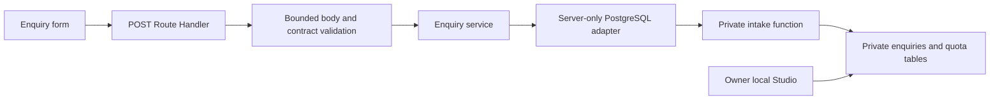

# Iteration 1B — Enquiry feature packet

Date: 2026-10-25, Australia/Brisbane. **Approved by owner; implementation in progress.**

This is the next feature packet, linked from [the 1B history](1b.md). The local Compose setup already works; this packet does not implement an enquiry form, operation or migration. The canonical OpenAPI/catalogue remain unchanged during planning. Baseline is the uncommitted tree based on `95c2c019ab9fc18728c9dfff1396973d0d505ef7`. Preserve the user-owned `next.config.ts`.

## Result to deliver

Add a modern `/enquire` page using the existing StrataDrive design, with name, email and an optional message. Add a clear enquiry entry in the existing navigation while retaining the labelled `/book` preview. The form is a local preview using synthetic details only.

Success means the enquiry was committed to local Supabase PostgreSQL. It does not reserve a lesson or imply instructor review. Notifications, real availability, bookings, payments, product login, CRM screens and deployment remain outside scope. No public enquiry listing, lookup, modification or deletion API is added.

Proposed acknowledgement: **“Your enquiry has been saved. No lesson has been booked. This preview sends no email.”** The form must identify that it accepts sample details only; business/privacy copy must not be invented.

## Architecture and private storage



Use the Node Route Handler runtime and `server-only` modules. Do not introduce a parallel Server Action mutation. Resolve and pin the `pg` driver/type packages during approved implementation. Move any validator packages needed by runtime into production dependencies.

Give the application a dedicated login, `stratadrive_enquiry_app`, with CONNECT, private-schema USAGE and EXECUTE on exactly one intake function. It gets no table CRUD, persistent schema creation, owner-role membership, administrative flags or `BYPASSRLS`. Remove inherited database TEMP permission for this reduced local environment, retaining explicitly required administrator permissions; verify the application cannot create temporary objects or change to the owner role. Do not give it the Compose database password, a Supabase service-role key or migration credentials.

Objects live in `enquiry_private`, excluded from PostgREST's exposed schemas. Use a distinct `stratadrive_enquiry_owner` NOLOGIN role, qualified object references and a fixed trusted function search path with `pg_temp` last. Create/grant the security-definer function and revoke default PUBLIC/anon/authenticated execution in one migration transaction. Enable and force RLS on private tables, with explicit policies for the function owner. Permit the existing local Studio administrator (`postgres`) SELECT through an explicit policy/grant so the owner can inspect synthetic receipts. Public API roles and the application login cannot read the tables.

RLS does not automatically constrain owners or bypass roles; these distinctions must be tested rather than inferred from the presence of RLS. See [PostgreSQL function security](https://www.postgresql.org/docs/17/sql-createfunction.html) and [row security](https://www.postgresql.org/docs/17/ddl-rowsecurity.html).

Store only enquiry ID, idempotency UUID, normalized name/email/message and the database-generated received timestamp, plus a separate quota bucket/count. The timestamp is stored in the committed row; it does not claim to be PostgreSQL's exact commit time. Compare the private normalized fields for retries: no additional PII digest or HMAC secret is needed. Use an admin-only migration ledger with version/checksum and an environment identity marker. No destructive down migration or arbitrary database URL is part of this packet.

Generate a separate application credential into owned, ignored local configuration. Never overwrite or inspect an unrecognized existing environment file. Configuration accepts only enumerated development/test loopback targets, expected database/role and environment marker; no production or arbitrary URL fallback. The app validates configuration before connecting and connects lazily, so building/static pages do not access a database. Use a small bounded pool, connection/query deadlines and parameterized calls.

## Contract to approve

Canonical operation after approval: `POST /api/v1/enquiries`, `operationId: createEnquiry`. Only this operation is added. All operation responses use JSON and `Cache-Control: no-store`; no contact data or retrieval URL is returned. Error codes and messages are fixed and contain no submitted values, driver messages, SQL or credentials.

| Input | Proposed rule |
| --- | --- |
| `Idempotency-Key` header | Required UUIDv4 generated by the form for one submission intent |
| Content type/encoding | UTF-8 `application/json`, optional UTF-8 charset; identity encoding only |
| Body | Closed object; unknown properties rejected; at most 8,192 actual streamed bytes, regardless of declared Content-Length |
| `name` | Required string, 1–100 Unicode code points; trim outer whitespace and normalize NFC; no controls/DEL, NUL or unpaired surrogates |
| `email` | Required string, at most 254 characters; trim, preserve local-part case and lowercase the domain; supported ASCII email syntax; no delivery/DNS verification claim |
| `message` | Optional plain text, at most 2,000 Unicode code points; NFC, CRLF/CR to LF, outer trim; empty/omitted normalize to NULL; allow tab/newline but reject other controls/DEL, NUL and unpaired surrogates |

Check raw wire-schema types/lengths and normalized values; whitespace normalization does not permit an over-limit raw field. Reject blank normalized names. Character limits and transport-byte limits are distinct; multibyte/escaped payloads can reach the byte limit first. Bound total body reading to five seconds and cancel rejected streams. Database validation must enforce stored-value limits too.

Example request (with a valid idempotency header):

```json
{"name":"Test Learner","email":"learner@example.test","message":"Synthetic enquiry for local manual testing."}
```

New and replayed success bodies have the same shape and original values:

```json
{"enquiryId":"5d826d0f-82a4-4867-ad59-38c850d9104d","receivedAt":"2026-10-25T01:00:00.000Z","status":"received"}
```

The timestamp in this example is illustrative. The actual timestamp comes from the committed database record.

| HTTP | Meaning / stable code |
| --- | --- |
| 201 | New committed enquiry |
| 200 | Same key and same normalized fields: original receipt replayed |
| 400 | Malformed JSON, invalid key/fields or unknown properties: `INVALID_REQUEST` |
| 403 | Rejected browser Origin/local target gate: `REQUEST_NOT_ALLOWED` |
| 408 | Body-read deadline exceeded: `REQUEST_TIMEOUT` |
| 409 | Existing key with different normalized fields: `IDEMPOTENCY_CONFLICT` |
| 413 | Actual body exceeds byte cap: `PAYLOAD_TOO_LARGE` |
| 415 | Unsupported media type/charset/content encoding: `UNSUPPORTED_MEDIA_TYPE` |
| 429 | Durable quota exhausted: `RATE_LIMITED`, with integer `Retry-After` seconds |
| 503 | Unconfigured/unavailable storage or bounded database timeout: `STORAGE_UNAVAILABLE` |
| 500 | Unexpected application fault: `INTERNAL_ERROR` |

Error shape: `{ "code": "INVALID_REQUEST", "message": "Check your enquiry details." }`, optionally with a closed `fieldErrors` object containing only `name`, `email` and/or `message` mapped to fixed safe messages. Missing fields/values are never echoed. Define separate closed enquiry schemas rather than accidentally extending the existing closed scaffold Error schema with `allOf`. Unsupported methods must not expose records; test Next.js's 405 behavior without promising an unspecified JSON body.

Browser submissions use a relative same-origin URL. Allow only the enumerated loopback app/test origins when Origin is present; reject foreign or `null` origins, emit no permissive CORS headers, and do not trust forwarded headers as client identity. Non-browser API tests may omit Origin. This is not authentication or bot protection.

## Atomic receipt, retry and local capacity rules

One database function/transaction takes a transaction-scoped serialization lock, checks an existing idempotency key, compares canonical fields, applies quota if new, inserts and returns only the receipt/result. A matching replay returns the original receipt before quota is charged. Conflicts disclose neither original fields nor original receipt. Rollback/connection failure never produces a success acknowledgement. Return success only after the database client confirms transaction completion.

Proposed local quota: **20 new enquiries per fixed ten-minute database-clock window**, globally across app instances. Persist the counter atomically with admission; no client IP, forwarded header or in-memory counter controls it. Replays consume no additional slot. Return the time to the next window in `Retry-After` (1–600 seconds). This is a local storage/capacity bound; public bot resistance, fairness and trusted-edge controls require a later launch decision.

Keep fields and the same intent key in memory after a failed/uncertain response; disable repeat submission while pending. Retry an unchanged intent with the same key. Do not automatically use a new key after timeout. Explain that a save may have completed and retry can confirm it. Editing or starting another intent after uncertainty requires an explicit choice rather than silently duplicating the old request.

Do not persist contact fields in browser storage or URLs. This increment does not promise recovery across refresh/new tabs: refreshing loses the draft and in-memory key. Stored keys/receipts do not expire automatically in this local slice; explicit guarded cleanup ends replay protection. No customer retention promise is made. Public retention/deletion policy remains an owner decision before real-data use.

## Logging, migrations and lifecycle

Before any statement carrying enquiry data or generated credentials, configure this project's PostgreSQL logging to suppress statement/parameter contents and error DETAIL/CONTEXT (`log_statement=none`, parameter logging limits zero, no error-statement logging, terse errors, or a verified equivalent). This must already be effective in administrator migration/role-provisioning sessions before password-bearing SQL, as well as in app sessions. Set bounded connection/statement/lock timeouts. Keep this configuration in project-owned files/roles and update their provenance; do not change Docker-wide settings. Use synthetic marker tests against provisioning, successful requests, validation and database/error paths to detect leakage without printing marker/secret values. Parameterized SQL alone is not proof of private logging; see [PostgreSQL logging settings](https://www.postgresql.org/docs/17/runtime-config-logging.html).

The app catches parse/driver failures and records only safe classifications and a random correlation identifier. No bodies, contact fields, tokens, raw driver errors or connection strings in routine logs/traces/responses. Browser bundles must contain no server credentials. Synthetic automated traces are kept local/CI artifacts; real customer information remains forbidden.

The guarded migration/credential preparation command must verify local engine, exact project/workdir, target port, image, environment marker and migration checksum before mutation. Preserve existing development rows, bootstrap credentials and volumes. Test private roles/functions after the existing guarded DB stop/start: that lifecycle reapplies its own public/default grants and must not break intake. Do not patch vendor artifacts silently or create empty scaffold layers unrelated to intake.

## Isolated tests and dual CI

Add a separate enumerated `stratadrive-test` Compose target with its own generated credentials, roles, volumes and loopback ports 55421/55422/55423. The existing development target stays on 54321/54322/54323. Reuse pinned official artifacts through a reviewed rendered configuration; reject wildcard port merges. Test/migration/cleanup helpers must reject remote targets, the development target in destructive mode, unknown labels/markers and resources owned by a different run.

Unit tests remain database-free. Add explicit discovery for `tests/unit/**/*.test.ts`: the current Vitest include would otherwise omit them. Run real database tests with a separate mandatory integration configuration/command; never skip them as a passing substitute when Docker is absent. Mocks cover isolated failure logic only.

Serialize real-database files and their shared quota/cleanup fixtures within the owned test run. Exercise concurrency deliberately inside individual cases, rather than letting unrelated files reset one another's state. Quota tests must prove the first 20 new admissions, rejection of the next, integer `Retry-After` in 1–600, replay while full and admission in a new window. Synchronize fixtures with the database clock and account for window-boundary rollover; use expired-bucket fixtures/controlled timing rather than a flaky wall-clock assumption or an application-accessible clock override. Explicitly test empty/omitted-message canonical equivalence and case/whitespace normalization for retry comparisons.

| Proposed test ID | File / principal acceptance |
| --- | --- |
| `TC-P1B-UNIT-001` | `tests/unit/enquiries/validation.test.ts`: normalization, raw/normalized lengths, Unicode and safe errors |
| `TC-P1B-CONTRACT-001` | `tests/contracts/enquiries.test.ts`: independent canonical request and every response/header/status schema |
| `TC-P1B-API-001` | `tests/api/enquiries.spec.ts`: actual POST, request budgets, invalid content, unknown fields, origin and methods |
| `TC-P1B-DURABLE-001` | `tests/integration/enquiries.persistence.test.ts`: actual private row/receipt, app restart, unavailable storage with no success |
| `TC-P1B-IDEMPOTENCY-001` | `tests/integration/enquiries.idempotency.test.ts`: concurrent/sequential replay, conflicting content and lost-response retry |
| `TC-P1B-ABUSE-001` | `tests/integration/enquiries.rate-limit.test.ts`: atomic capacity, replay under full quota, restart and spoofed-header resistance |
| `TC-P1B-SECURITY-001` | `tests/integration/enquiries.permissions.test.ts`: effective role/RLS/DDL denial, no public reads, lifecycle survival and log/bundle canaries |
| `TC-P1B-E2E-001` | `tests/e2e/enquiries.spec.ts`: truthful saved state, failures, retained input, stable retry, no notification/reservation |
| `TC-P1B-A11Y-001` | `tests/e2e/enquiries-accessibility.spec.ts`: focus/error associations/status announcements, keyboard/mobile/zoom and scoped axe |
| `TC-P1B-OWNER-001` | This packet plus manual guide: local synthetic walkthrough and explicit owner disposition |

Keep Playwright in production mode through `start:test` on port 3100, with an explicit isolated **test** store configuration. Building must not connect to either database. Manual API/E2E commands prepare/acquire an isolated test run and clean only its resources in `finally`; CI can reuse one prepared test run across serial suites. Do not reset the owner's development records or use broad Docker prune/reset commands.

Extend the shared CI runner with a mandatory integration gate and coordinated required-check manifest/tests. Both GitHub and Azure must independently build/validate the same GitHub SHA with the same scripts, ephemeral local credentials and isolated containers, then clean up in `finally`. Fail if Docker/Compose or a required check is unavailable. Existing remote activation/parity evidence remains pending; this packet does not authorize service connections, remote pipeline activation or deployment.

## Traceability and contract integration

The following identifiers became canonical with owner approval. Actual execution evidence and pending acceptance are recorded separately in the iteration history:

| Business outcome | Technical/nonfunctional mapping | Operation / cases |
| --- | --- | --- |
| `BR-P1-ENQ-001`: honest enquiry acknowledgement | `TR-P1-ENQ-001`, `TR-P1-DURABLE-001`, `TR-P1-RETRY-001` | `createEnquiry`; UNIT, CONTRACT, API, DURABLE, IDEMPOTENCY, E2E |
| `BR-P1-PRIV-001`: minimal protected contact data | `NFR-P1-PRIV-001`, `NFR-P1-ABUSE-001` | `createEnquiry`; SECURITY, ABUSE, A11Y as applicable |
| Existing local review/history requirements | `TR-LOCAL-001`, `TR-HISTORY-001` | Justified API N/A; OWNER and history procedure |

After approval, integrate contract/catalogue/tests together without weakening active-scope completeness. Add duplicate-operation-ID rejection and reciprocal `x-requirement-ids` validation. Use inline operation headers/responses because the current validator permits only component-schema references. Every component has examples; example validation is not live API coverage.

Generate a deterministic server schema module from the canonical OpenAPI component definitions, with a drift check in contract validation. The app uses that generated schema, not an independently maintained request schema. Tests independently read the canonical contract. Keep the generated file checked in so `npm start` works on a normal checkout; contract changes require regeneration and checked output before handoff.

## Proposed file ownership after approval

One writer per file; reservations below replace prior setup reservations for these paths. Planner/Critic remain read-only; reviewer permission restrictions must still be disclosed as procedural unless a separate boundary is actually verified.

| Writer | Proposed files / purpose |
| --- | --- |
| Orchestrator | `contracts/openapi.yaml`, `docs/requirements.yaml`: approved operation, schemas, links and evidence references |
| Orchestrator | `scripts/check-traceability.mjs`, `scripts/validate-contract.mjs`, new `scripts/generate-contract.mjs`, `src/server/enquiries/schema.generated.json`: reciprocal links, duplicate IDs and canonical runtime schema |
| Orchestrator | `scripts/local-supabase.mjs`, new `scripts/enquiries-local.mjs`, `infra/local-supabase/targets.json`, Compose/provenance/shared local setup files: guarded profiles, logging, preparation and cleanup |
| Orchestrator | package/lock, `vitest.config.mts`, integration config, `playwright.config.mts`, `scripts/ci.mjs`, GitHub/Azure YAML and docs: dependencies, discovery, isolated lifecycle and coherent CI |
| Developer | `src/app/enquire/page.tsx`, `src/components/site/enquiry-form.tsx`, header/footer/homepage and `src/app/globals.css`: form and enquiry navigation using existing design |
| Developer | `src/app/api/v1/enquiries/route.ts`, `src/server/enquiries/{validation,service,repository,config}.ts`: bounded adapter/service/least-privilege data access; excludes root-owned generated schema |
| Developer | `supabase/migrations/202610250001_enquiry_intake.sql`: private schema, explicit grants/RLS/function/quota and versioned setup changes |
| Tester | The nine automated test files listed above, `tests/helpers/enquiries-fixtures.ts`, affected traceability/CI-identity regressions and assigned existing UI checks |
| Planner / Critic | Read-only packet, canonical contract and integrated-candidate reviews |

Resolve actual dependency versions from primary sources during implementation, pin them and update the lockfile serially. Do not edit the existing user-owned Next configuration. Any additional file reservation must be recorded before editing.

## Acceptance and owner handoff

### 2026-10-25 continuation ownership

Owner instruction “go now” resumes the approved implementation against baseline `95c2c019ab9fc18728c9dfff1396973d0d505ef7` and its existing uncommitted candidate. Preserve all prior changes, especially `next.config.ts`. Root retains the shared-file reservations above, including `scripts/start-local.mjs`, all handoff/history documentation and ignored validation reports. The prior implementation is present; missing independent tests and integrated verification are being completed.

`database_tests` exclusively writes the four `tests/integration/enquiries.*.test.ts` files and `tests/helpers/enquiries-fixtures.ts`. `browser_tests` exclusively writes the enquiry unit/contract/API/E2E/accessibility tests and affected existing traceability/CI/UI tests listed in its dispatch, plus `tests/tooling/enquiries-lifecycle.test.ts`. Both Testers have now explicitly handed those paths back to root for integration. Root additionally owns `tests/package.json`, an ESM test-runner boundary needed for the `.mjs` guarded helpers. `packet_audit` is read-only. No other writer may edit these paths before explicit handoff. Tests execute serially against the guarded test target; root coordinates Docker lifecycle. Agent restrictions are procedural because the Windows sandbox process helper fails before startup; elevated commands are not evidence of enforced reviewer isolation.

Implementation order: approve packet -> canonical contract/traceability and test discovery -> isolated target/logging/migration/role setup -> request/service/form implementation -> independent real-database/API/browser/security review -> integrated checks -> owner walkthrough. Keep contract/tooling, shared manifests and generated files serialized between writers.

Acceptance requires every proposed case above to execute, actual commit and restart verification, concurrent idempotency/quota evidence, effective role denials, no detected synthetic PII/secret leakage in the scoped canary tests, and an accessible usable form. Run appropriate lint/types/contracts/unit/build/integration/API/E2E checks; record limitations rather than calling a skipped check passed. No universal security or accessibility certification is claimed.

Proposed manual workflow, to be verified and added to README during implementation:

```powershell
Set-Location 'D:\Projects\stratadrive'
npm run enquiries:local:prepare
npm start
```

`enquiries:local:prepare` is implemented. It guards/starts the development target, applies checked migrations and generates narrow app configuration. Current verified commands and scope are in README and the manual guide. Keep the app terminal open; stop it with Ctrl+C. Database stop remains `npm run db:local:stop`.

Visit `/enquire` at `http://127.0.0.1:3000/enquire` only after implementation. Submit the example sample details, see a saved/not-booked acknowledgement and inspect the matching row in Studio's private schema. Separately, the implementation handoff must supply a guarded API procedure with a fixed explicit test UUID/body to replay across app restart and verify the same receipt/row. This does not imply browser in-memory state survives refresh/restart. Exercise a controlled unavailable-store case: no success, retained input and safe retry. Provide safe scoped sample cleanup and clear recovery steps; no public lookup endpoint is added for verification. Record the owner's accepted/changes-requested disposition separately from tests.

Real business contact/service facts, customer privacy/retention/deletion policy, trusted-edge abuse controls, operational access and public hosting remain pre-launch decisions. They do not prevent this synthetic local preview, and approving this packet does not authorize real customer data, production secrets, external infrastructure or deployment.

## Independent planning evidence

Planner, Tester and Critic independently reviewed the repository/constraints read-only. They recommended the private execute-only database boundary, canonical contract integration, real isolated persistence tests and explicit manual review. Critic highlighted logging, function-owner/RLS semantics, default grants and restart interactions. Tester identified excluded unit-test paths, missing reverse traceability/duplicate checks and the need for a separate test store. No planning review ran tests, mutated a database or approved implementation behavior.

Orchestrator consolidated these recommendations, choosing a 20-per-ten-minute fixed local quota, 201/200 receipt semantics, direct private canonical-field comparison and in-memory draft/retry state. These are proposed defaults for owner approval, not claimed business policy or implemented functionality.
