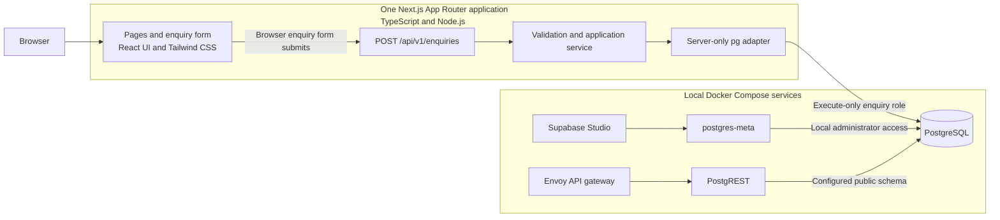

# Technology stack

## Local development environment

StrataDrive is developed locally on Windows.

Development tools:

- Node.js
- npm
- Git
- PowerShell
- Docker Desktop
- Docker Compose
- Windows Subsystem for Linux
- Supabase CLI (retained tooling)

## Main technology stack

### Frontend

- React
- Next.js App Router
- TypeScript
- Tailwind CSS

Frontend URL:

```text
http://127.0.0.1:3000/
```

### Backend

- Node.js
- Next.js Route Handlers
- TypeScript
- `pg` PostgreSQL driver
- AJV validation

The frontend and backend run in the same Next.js application.

Enquiry API endpoint (POST):

```text
http://127.0.0.1:3000/api/v1/enquiries
```

### Database

- PostgreSQL through local Supabase
- Supabase Studio
- SQL migrations

Local database: `postgres`

Private enquiry schema: `enquiry_private`

Database dashboard:

```text
http://127.0.0.1:54323/project/default/editor
```

### Testing and quality

- Vitest
- Playwright
- Postman for manual API requests
- axe accessibility checks
- ESLint
- OpenAPI and Redocly

### Source control and CI

- GitHub as the authoritative repository
- GitHub Actions
- Azure Pipelines

The project source is published to the owner-approved public GitHub repository for peer review. Its first push triggered GitHub Actions validation. Successful remote validation evidence, Azure activation and matching-source comparison remain pending; see the dated [publication receipt](iterations/1b.md#2026-10-28--github-publication-receipt).

Versions, component purposes, the architecture diagram and source references follow below.

---

## Full details

This is StrataDrive's single maintained technology-stack reference: the current components, their purpose, versions, connections and implementation status. Other documents link here for the stack and retain their own procedures, design rules or dated decisions.

Reviewed **28 October 2026**, covering the implementation through Iteration 1B and the public GitHub peer-review snapshot. Component versions and the local application/database topology are unchanged by publication. Local synthetic enquiry intake is implemented and locally verified; explicit owner feature/manual acceptance remains pending. See [progress](progress.md) and [Iteration 1B](iterations/1b.md) for execution evidence and acceptance.

### Visual overview



The enquiry application connects directly to PostgreSQL through `pg` and the private `enquiry_private.submit_enquiry` function. It does not send enquiry writes through PostgREST or a browser Supabase client. Studio uses the metadata service for local administrator inspection. PostgREST is configured for the public schema; the private enquiry schema is outside that API.

The homepage and booking journey are previews. Enquiry saves produce a durable local receipt, without reserving a lesson or sending a notification.

### Application and runtime

Versions below are the reviewed repository baseline. Node is pinned by [.node-version](../.node-version); npm is specified in [package.json](../package.json). npm dependency versions are resolved by [package-lock.json](../package-lock.json), including dependencies declared with version ranges.

| Component | Version | Purpose | Implementation reference |
| --- | --- | --- | --- |
| Node.js | 22.15.0 | Application and tooling runtime; the enquiry HTTP handler uses the Node runtime | [Local launch runner](../scripts/start-local.mjs) |
| npm | 10.9.2 | Dependency installation and project commands | [Scripts and package manager](../package.json) |
| Next.js | 16.4.3 | App Router pages, server rendering, Route Handlers and local development/build tooling | [Application routes](../src/app), [enquiry HTTP handler](../src/app/api/v1/enquiries/route.ts) |
| React and React DOM | 19.3.0 | Page components, interactive navigation, booking preview and enquiry form | [Site components](../src/components/site) |
| TypeScript | 5.9.3 | Static typing with strict checks | [Compiler configuration](../tsconfig.json) |
| Tailwind CSS and its PostCSS plugin | 4.3.3 | Application styling and CSS processing | [Styles](../src/app/globals.css), [PostCSS configuration](../postcss.config.mjs) |
| `pg` | 8.23.1 | PostgreSQL connection pooling and parameterized server-side calls; no ORM is used | [Enquiry repository](../src/server/enquiries/repository.ts) |
| `server-only` | 0.0.1 | Import boundary for application services and database access | [Application service](../src/server/enquiries/service.ts) |
| AJV and `ajv-formats` | 8.20.0 and 3.0.1 | Runtime JSON Schema 2020-12 validation and format checks against generated contract schemas | [Validation](../src/server/enquiries/validation.ts), [generated schema](../src/server/enquiries/schema.generated.json) |
| Geist fonts through `next/font/google` | Provided by Next.js | Application typography; builds currently need network access to fetch the fonts | [Root layout](../src/app/layout.tsx) |

### Local database and supporting services

The reduced Supabase distribution runs five Docker services. Exact image tags come from [compose.local.yaml](../infra/local-supabase/compose.local.yaml); the lifecycle guard also checks the approved image/configuration pins. [Provenance](../infra/local-supabase/provenance.json) records upstream/local artifact hashes and licensing references. These executable files remain authoritative.

| Compose service | Pinned image | Purpose | Published loopback ports: development / test |
| --- | --- | --- | --- |
| `db` | `supabase/postgres:17.6.1.136` | PostgreSQL 17 with private enquiry schema, SQL migration, least-privilege roles, receipts, replay protection and admission quota | 54322 / 55422 |
| `rest` | `postgrest/postgrest:v14.18` | Supporting REST service for the configured public schema | Internal network only |
| `meta` | `supabase/postgres-meta:v0.100.0` | Database metadata/administration used by Studio | Internal network only |
| `studio` | `supabase/studio:2026.10.12-sha-3699278` | Local synthetic-data administrator dashboard | 54323 / 55423 |
| `api-gw` | `envoyproxy/envoy:v1.39.1` | Gateway for the reduced local distribution | 54321 / 55421 |

Docker Desktop supplies the local Linux engine and Compose on the Windows workstation, with WSL 2 prerequisites enabled. Its last recorded setup baseline was Desktop 4.96.3 / engine 29.9.2; those host-tool versions are historical verification, not repository pins or a new live check. CI definitions target Linux hosted runners.

[Target profiles](../infra/local-supabase/targets.json) separate the development and leased test projects, ports and volumes. The application uses loopback port 3000 for owner development/review and 3100 for automated production-mode serving. Database changes live in [versioned migrations](../supabase/migrations); the application uses a dedicated execute-only role. The test runner manages its own isolated services and cleanup.

Use [README](../README.md) for the current command/URL index, [the local database runbook](local-supabase.md) for service lifecycle/recovery and [manual testing](manual-testing.md) for synthetic inputs and expected behavior. The Excel workbook's **Start Here** tab provides ordered review startup. These are operational instructions rather than separate stack inventories.

### Contracts, validation and development tooling

| Component | Version or definition | Purpose | Authority / configuration |
| --- | --- | --- | --- |
| OpenAPI | 3.1.0 | Canonical business HTTP contract, currently the public synthetic `createEnquiry` operation | [Contract](../contracts/openapi.yaml) |
| Redocly CLI | 2.71.0 | OpenAPI document linting | [Lint configuration](../redocly.yaml) |
| `yaml` | 2.9.1 | Reading canonical contracts and requirement catalogues in tooling | [Contract validation](../scripts/validate-contract.mjs), [traceability](../scripts/check-traceability.mjs) |
| ESLint and Next.js lint configuration | 9.39.5 and 16.4.3 | Static source checks | [Lint configuration](../eslint.config.mjs) |
| Vitest | 5.0.5 | Tooling/contract/unit tests and separately configured real database tests | [Unit configuration](../vitest.config.mts), [integration configuration](../vitest.integration.config.mts) |
| Playwright Test | 1.64.1 | Actual HTTP and Chromium browser tests, with production-mode serving | [Playwright configuration](../playwright.config.mts) |
| Postman | External manual client; not pinned by the repository | Importable local API requests, examples and response assertions; native client execution remains for the owner | [Collection and local environment](../postman/README.md) |
| axe integration for Playwright | 4.14.0 | Scoped automated accessibility checks within browser tests | [Browser tests](../tests/e2e) |
| Supabase CLI | 2.122.0 | Retained project setup/tooling dependency | [Dependency declaration](../package.json), [local runbook](local-supabase.md) |

The supported database startup uses the guarded Compose helpers, rather than `supabase start`. The CLI dependency does not imply a hosted project connection or a running full Supabase distribution.

[Testing and independent CI](testing-and-ci.md) owns the ordered nine-gate procedure, source-identity comparison, reports and execution limits. Test results and manual acceptance remain in dated iteration history and manual workbooks; a tool inventory does not establish a pass.

### Source control and CI status

| System | Role | Current status / source |
| --- | --- | --- |
| Git / GitHub | Version control and the sole authoritative repository | Public [LearnerSec2024/stratadrive](https://github.com/LearnerSec2024/stratadrive), branch `master`, published for owner-authorized peer review; [governance](../AGENTS.md) |
| GitHub Actions | Primary validation definition, targeting `ubuntu-24.04` | [Workflow](../.github/workflows/ci.yml) triggered by the first push; completed successful remote evidence is not yet recorded |
| Azure Pipelines | Independent validation of the same immutable GitHub source, targeting `ubuntu-24.04` | [Pipeline](../azure-pipelines.yml) prepared locally; remote activation and matching-SHA parity are pending |

Both definitions use the shared [CI runner](../scripts/ci.mjs), install/build independently and contain validation/reporting steps. Neither defines a deployment stage. Local validation is separate from remote execution evidence.

### Scope and deferred choices

Current use is local development and synthetic testing. Product authentication, live availability/reservations, payments, notifications/email, hosted Supabase and production hosting/deployment are not implemented or activated by this stack. The reduced Compose setup omits Auth, Storage, Realtime, Edge Functions and analytics services. Visible Studio navigation does not make those services available.

Future hosting, identity and communication choices require approved requirements/design and a task packet. Keep proposed technologies explicitly labelled as proposed until implemented and verified; do not add them to the current inventory on the strength of a plan alone.

### Maintenance

The orchestrator owns this reference and assigns one writer when updating it. For every approved stack addition, removal, version change or topology/status change:

1. Verify the actual change in dependency/lock files, runtime pins, container configuration, contract/configuration or implementation. Executable source wins if this document disagrees; correct this document in the same change.
2. Update the version-free summary lists and affected detail tables, diagram, status and reviewed date here. Keep the current explanatory inventory here instead of copying it into other guides.
3. Update affected startup/testing/security procedures and links where behavior or prerequisites change. Preserve historical ADRs, iteration evidence and the owner's manual results; later workbooks carry current prerequisites in their Start Here tab.
4. Record the decision, changed files, verification and acceptance boundary in [progress](progress.md) and the applicable iteration record. Check local links, documented versions and diagram/data-flow accuracy before handoff.

Architecture rules live in [architecture](architecture.md); product scope in [the roadmap](project.md); operational security in [security](security.md); and historical rationale in [ADRs](adr/0001-foundation-boundaries.md) and iteration records. Those documents link here for the current stack rather than maintaining competing catalogues.
